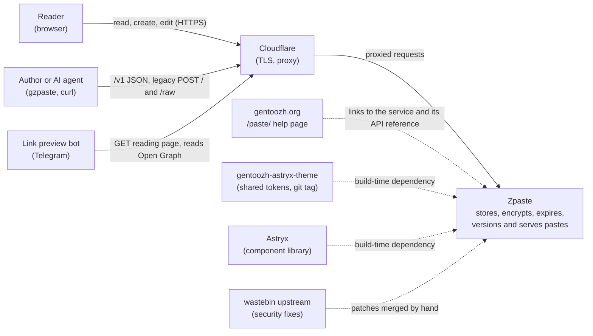
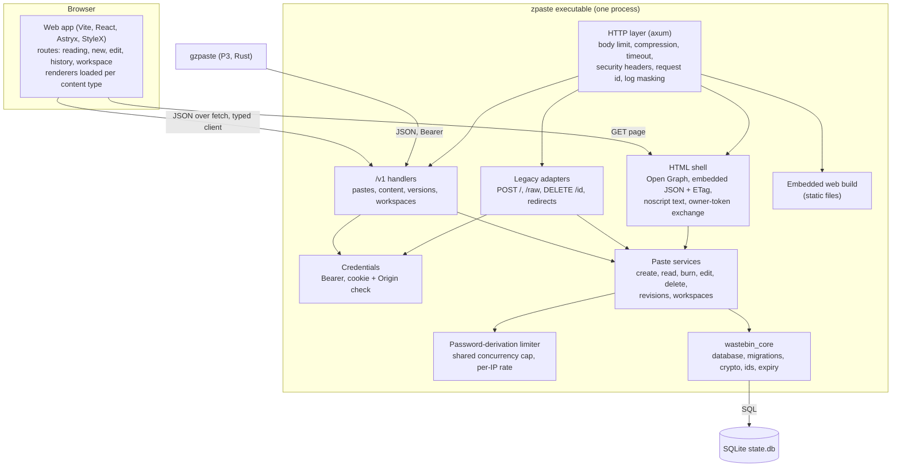
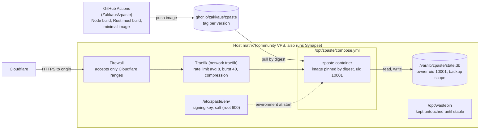
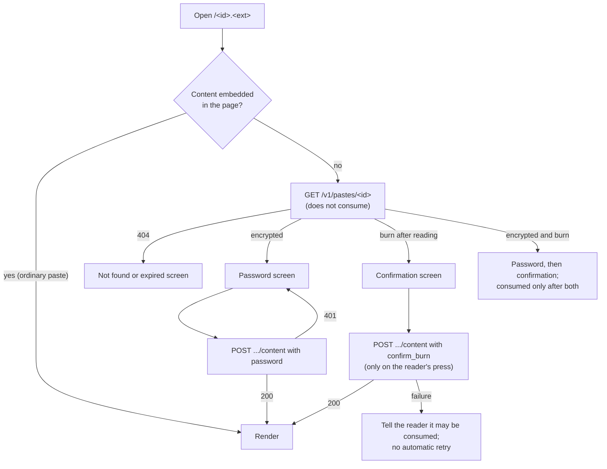
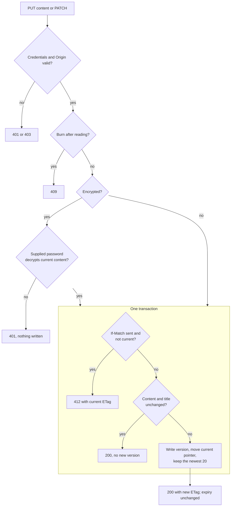

# Zpaste architecture

This document describes the structure Zpaste is being built towards and the
rules that structure must keep. Most of it is the **target** from the working
plan, [plan.zh-TW.md](plan.zh-TW.md) (v12), and is not implemented yet. The
code in this repository today is upstream wastebin at commit `c0ec968` with the
server executable renamed to `zpaste`; the README's "Status" section is the
short statement of that.

Every section carries one of these labels:

- **Current**: true of the code on `main` today.
- **Target**: decided in the plan, not implemented. The phase that builds it is
  named.
- **Open**: the plan does not decide it. Each open item is listed in
  [Open items](#open-items) with the phase it blocks.

Interface values and visual rules are in [design-language.md](design-language.md).
Branches, reviews, phases and the deployment runbook are in
[workflow.md](workflow.md). Numbers and gates are in
[REQUIREMENTS.md](../REQUIREMENTS.md); rules for writing code are in the
`AGENTS.md` files. This document does not repeat them.

## Invariants

Each row is a property the system keeps in every phase. The right column says
what fails when it is broken, so a change can be judged against it.

| # | Invariant | When it is broken | State |
| --- | --- | --- | --- |
| 1 | The `/v1` handlers and the legacy routes call the same service functions. A legacy route is an adapter that translates the request and the response, nothing more. | Two entry points grow two sets of rules, and an anonymous `curl` gets behaviour the web page does not. | Target, P1 |
| 2 | `WASTEBIN_SIGNING_KEY` and `WASTEBIN_PASSWORD_SALT` carry over unchanged across every deployment, including the upstream default salt `somesalt` when none was set. | Every owner token stops verifying, and every encrypted paste becomes unreadable. | Current (upstream reads both); kept by the runbook |
| 3 | A burn-after-reading paste is consumed only by `POST /v1/pastes/{id}/content` with `confirm_burn`. No `GET` consumes content. | A link preview, a crawler or a page reload burns the paste before the reader sees it. | Target, P1 |
| 4 | The HTML shell of an encrypted or burn-after-reading paste carries no content, no title and no summary. | The content or its title reaches link previews, caches and anyone with the URL. | Target, P1 |
| 5 | Content embedded in the HTML shell is JSON with `<`, `>`, `&`, U+2028 and U+2029 escaped; Open Graph attributes and `<noscript>` text use HTML escaping; the Content Security Policy allows no inline script. | A paste containing `</script>` ends the data block early and runs as script on the paste's origin. | Target, P1 |
| 6 | A version id is a SHA-256 over the parent id, the stored bytes (the ciphertext for an encrypted paste) and the title (presence flag, length and bytes). | Someone without the password confirms a guessed plaintext by hashing it, or an `ETag` matches content it does not describe. | Target, P1 |
| 7 | Editing an encrypted paste first decrypts the current content with the supplied password; a failure returns 401 and writes nothing. | A mistyped password silently becomes the paste's new password. | Target, P2 |
| 8 | A write authenticated by cookie must carry an `Origin` equal to the configured public URL (scheme, host and port); forwarded headers are not trusted. Bearer requests skip this check. | Another site makes the reader's browser edit or delete their pastes (CSRF). | Target, P1 |
| 9 | A Bearer token that fails verification returns 401. The server never mints a new identity in its place. | A client's pastes split across identities without notice, and "my pastes" loses some of them. | Target, P1 |
| 10 | Every path that runs the password key derivation shares one concurrency limit and one per-IP rate limit, and answers 429 with `Retry-After` past it. | Parallel wrong-password requests exhaust memory: each derivation takes 64 MiB. | Target, P1 |
| 11 | The client IP is taken from `CF-Connecting-IP` only when the connection comes from a Cloudflare address range; otherwise from the connection itself. | A client sets the header and escapes the rate limit. | Target, P1 |
| 12 | An expired paste and a missing paste give the same 404, and a paste's history is deleted with it. | The API tells a caller which ids existed, and history outlives the paste it belongs to. | Target, P1 (404), P2 (history) |
| 13 | The OpenAPI file is generated from the Rust handlers, and the frontend types are generated from that file; neither is edited by hand. | Server and client drift apart while both still compile. | Target, P0 draft, P1 checks |
| 14 | A failed migration stops the server before it serves traffic. | The server accepts requests against a half-migrated schema and writes bad rows. | Current (upstream migrates at start-up) |
| 15 | Logs never contain `Authorization`, `X-Paste-Password`, the `owner` query parameter or the body of a create response. | An owner token or a password is readable by anyone with log access. | Target, P1 |
| 16 | `?owner=` is exchanged before any HTML is produced: the server stores the token in a cookie and answers 302 to the same URL without the token, with `no-store`. | The token stays in browser history, `Referer` headers and caches. | Current (cookie and 302, `paste.rs`); Target, P1 (`no-store`) |

## System context

Who and what Zpaste talks to. Zpaste is one service at one URL,
`paste.gentoozh.org`; it shares a design system with gentoozh.org, not a site.



| Element | Responsibility | Dependency type |
| --- | --- | --- |
| Zpaste | Everything about a paste: storage, encryption, expiry, burn-after-reading, versions, workspaces, the HTML shell and the browser app. | This repository |
| Cloudflare | TLS termination and the only network path to the origin. | External, runtime |
| gentoozh.org `/paste/` | Explains the service and links to it. It does not host pastes. | External, links only |
| `gentoo-zh/gentoozh-astryx-theme` | Shared theme tokens for gentoozh.org and Zpaste. Each consumer pins a git tag. | External, build time |
| Astryx | Components that render Markdown, outlines, code blocks, tables and tabs. | External, build time |
| wastebin upstream | Source of the storage, encryption and expiry code and of later security fixes. Upstream frontend changes are not merged. | External, source only |

Current: the deployed service is upstream wastebin; the browser talks to
askama-rendered pages and the upstream API.

## Containers

The parts inside the one executable, and the browser app it ships. Target
unless marked; P1 builds the shell, `/v1` reading endpoints and the reading
page.



| Container | Owns | Must not |
| --- | --- | --- |
| HTTP layer | Limits, compression, timeouts, security headers, `X-Request-Id`, log masking, the uniform error JSON for every rejection including axum's own. | Decide anything about a paste. |
| HTML shell | The four things the server renders for a page: Open Graph tags, the embedded content JSON and its `ETag`, the `<noscript>` text, and the `?owner=` exchange. | Render Markdown, highlight code, or embed anything for an encrypted or burn-after-reading paste. |
| `/v1` handlers | Request and response shapes, status codes, `ETag` and `If-Match`, OpenAPI annotations. | Hold business rules; they call the services. |
| Legacy adapters | Translating upstream-shaped requests and responses. | Hold rules of their own (invariant 1). |
| Credentials | Verifying Bearer tokens and cookies, the `Origin` rule for cookie writes. | Mint an identity when verification fails (invariant 9). |
| Password-derivation limiter | One limit for every path that derives a key from a password. | Be bypassed by a path that decrypts (invariant 10). |
| Paste services | Create, read, burn, edit, delete, revisions, workspaces, each in one transaction where the plan says so. | Know about HTTP. |
| `wastebin_core` | Storage, migrations, encryption, ids and expiry, kept close to upstream. Crate names are not renamed, so upstream patches apply with fewer conflicts. | Depend on the server crate. |
| Web app | Rendering, routing, state, i18n and theme. It runs against any wastebin-compatible server through the Vite proxy in development, without CORS. | Hand-write a request: the client is generated from the OpenAPI file. |

Current: `wastebin_server` serves askama templates with server-side
highlighting through `wastebin_highlight`; `wastebin_ctl` is a database tool;
`wastebin_theme_showcase` renders the highlighting themes. What becomes of
`wastebin_highlight` and `wastebin_theme_showcase` once the templates are
removed is open.

## Deployment

Target from P1 on. Current: the service runs from `/opt/wastebin` on the same
host with an image built from upstream master, behind the same Traefik and
Cloudflare.



| Part | Responsibility | Notes |
| --- | --- | --- |
| Image build | Three stages: Node builds the web app, Rust builds a static musl executable that embeds it, a minimal base (distroless or scratch) runs it as uid 10001. | The CI change is a separate P0 task. |
| Registry | `ghcr.io/zakkaus/zpaste:<version>`. Compose pins the digest, not the tag, so a rollback is a digest swap. | The version scheme is open. |
| Configuration | `/etc/zpaste/env`, root 600, values moved from the current setup unchanged (invariant 2). Variables keep the `WASTEBIN_` prefix. | |
| Data | `/var/lib/zpaste/state.db`, owned by uid 10001. Backups cover `/var/lib/zpaste`. | The backup schedule is open. |
| Network | Target: Cloudflare is the only way in; the host firewall accepts origin traffic from Cloudflare ranges only. Host rules (firewall edits, rootless Docker) are in [workflow.md](workflow.md#deployment-and-rollback). | |

## Serving a page: HTML shell, embedded JSON, browser app

Target, P1. The server renders a thin HTML shell for every reading page; the
browser app renders the content. The server outputs only four things beyond
static files:

1. Open Graph tags (title, type, the first lines) so a Telegram preview shows
   what the paste is.
2. For an ordinary paste, the content and its `ETag` as embedded JSON, so the
   app does not fetch it a second time.
3. A `<noscript>` block with the plain text, so a reader without JavaScript can
   still read an ordinary paste.
4. The `?owner=` exchange (invariant 16), done before any HTML. Upstream
   already does it; `no-store` is the P1 addition.

Encrypted and burn-after-reading pastes get a shell with a generic title and no
content (invariant 4). They cannot be read without JavaScript. Pastes are served
with `noindex`; the help page on gentoozh.org stays indexable.

Why this split:

- Upstream renders everything on the server. The sample paste in the plan
  (76 KB of text) produced 754 KB of HTML with 12,612 inline highlighting spans.
  Sending the text and rendering in the browser removes that cost.
- A browser-only app without a server shell loses the link preview and
  no-JavaScript reading, and needs a second request before the first paint.
- Rendering Markdown on both sides would mean two renderers, in Rust and in
  TypeScript, that must agree; the shell keeps rendering in one place.

How the app gets content:



The reading URL is `/<id>[.<ext>]`. The renderer comes from the URL's extension
when it has one, otherwise from the extension stored at creation, otherwise
plain text. Other app routes are `/<id>/edit`, `/<id>/history`, `/` (new paste),
`/w/<slug>` (workspace) and `/w/<slug>/<name>` (one entry of it).

The Content Security Policy keeps upstream's strict base and adds
`connect-src 'self'`. The start-up script is an external file. The only
escaping Zpaste writes itself is the shell's JSON embedding (invariant 5);
everything the app renders relies on the libraries: Astryx `Markdown` turns
Markdown into React elements and never renders raw HTML, mermaid runs with
`securityLevel: 'strict'`, and mind map nodes are React text.

## API layer

Target, P1 for reading and create, P2 for edits and versions, P2b for
workspaces. The full endpoint table, field list and error format are in the
plan, section 四. Once the OpenAPI file exists it is the authoritative
reference, and this section keeps only the rules behind it.

- **Style.** OpenStack-like: resources under `/v1`, bodies wrapped in the
  resource name (`{"paste": {...}}`), `links` with `self` and `bookmark`,
  marker paging with `next` links only. `GET /v1` reports
  `{"version": {"id": "v1", "status": "CURRENT"}}`.
- **Errors.** Every endpoint, axum's own rejections included, returns one JSON
  shape, wrapped as `{"error": {...}}`, with the fields `code`, `type`, `title`,
  `message` and `request_id`.
- **Request ids.** A client's `X-Request-Id` matching `[A-Za-z0-9-]{1,64}` is
  kept; otherwise the server makes one. Every response carries it.
- **Caching.** Every `/v1` response is `no-store`.
- **Status codes.** 401 means no or invalid credentials; 403 means valid
  credentials for someone else's paste. 409 means the paste needs a password
  or a burn confirmation, or cannot be edited because it burns. 412 means
  `If-Match` does not match the current version.
- **Passwords.** In the JSON body when reading content. In
  `X-Paste-Password`, as base64url of the UTF-8 password, on `PUT` and `PATCH`,
  because a `PUT` body is the raw text.
- **Metadata whitelist.** `GET /v1/pastes/{id}` never returns the uid, and
  never returns the title of an encrypted paste.

Credentials decide the CSRF rule:

| Credential | Who uses it | Rule |
| --- | --- | --- |
| None | Anonymous `curl`, gzpaste on first create, readers | May create, read public content, read with a password, confirm a burn. |
| `Authorization: Bearer <owner_token>` | gzpaste, scripts | Browsers do not send it on their own, so no `Origin` check. |
| Cookie | The web app | Writes need a matching `Origin` (invariant 8); missing, `null` or foreign is 403. |

The plan decided Bearer as the only token header (plan section 八, item 4).
Old gzpaste versions that delete by cookie without `Origin` are rejected from
P1 on; the owner confirmed old clients need no compatibility, and the new
gzpaste ships with P1.

The contract pipeline: utoipa annotations on the handlers produce the OpenAPI
file, committed to the repository; openapi-typescript turns it into frontend
types; openapi-fetch is the typed client. All three are pinned (A1, settled
in P0): utoipa 6.0.0, openapi-typescript 7.13.0 with TypeScript 5.9.3, and
openapi-fetch 0.17.0; `docs/api/README.md` records the check and what utoipa
cannot express. CI regenerates both outputs and
compares them byte for byte, type-checks the frontend, and runs a contract test
that starts the server in-process and sends every row of the endpoint table
implemented so far, each error status included, validating status, headers
and body against the OpenAPI file. The regeneration check alone cannot show
that a handler answers as the file says, which is why the contract test exists.

## Identity model

Current: upstream already has the pieces. An identity is a paste's `uid`; the
owner token is the server's signature over it, made with
`WASTEBIN_SIGNING_KEY`. Upstream's create endpoint reuses the uid of a valid
token passed in the body, and the browser keeps tokens in a signed cookie.

Target, P1:

- The first create without credentials mints an identity; the response carries
  `owner_token` once and never again.
- Later creates send `Authorization: Bearer <owner_token>` and stay in the same
  identity, so `GET /v1/pastes?owner=me` lists all of its pastes.
- The web app keeps the same token in a same-site cookie, in upstream's cookie
  format, which holds several identities and creates with the first.
- `?owner=` moves one's own identity to another machine or browser
  (invariant 16). Current except `no-store`, which is P1 work.
- Permission is per identity, not per paste. A shareable edit link is not
  offered.

The list endpoint filters by identity and expiry first, then pages, newest
first by `(created_at, id)`. Pastes from before the migration have no
`created_at` and sort last. A `marker` that is malformed, deleted or another
identity's gives one 400, so it reveals nothing about the id.

## Revisions

Current: the `revisions` table exists (migration 8). Every create writes
version 1 in the same transaction as the paste, and the migration wrote version 1
for every older paste, so the `version_id` and `ETag` of a create response will
be real from the first day. Target, P1: the `/v1` responses carry them. Target,
P2: edits.

A version id is a hash chain, as in git:

```text
version_id = sha256( parent_id (32 bytes; empty for the first version)
                   || u64be(len(data)) || data            data = stored bytes, ciphertext when encrypted
                   || u8(has_title) || u32be(len(title)) || title (UTF-8) )
```

It is written as 64 lowercase hex digits, and the `ETag` is `"<version_id>"`,
compared strongly (RFC 9110). Hashing ciphertext keeps the id useless for
guessing content (invariant 6). Restoring older content still produces a new id,
because the parent differs. The integer `version` is the chain depth and is
used only for ordering and display.

Edits through `PUT /v1/pastes/{id}/content` and `PATCH /v1/pastes/{id}` follow
one rule set:



- Encrypted edits reuse the supplied password with a new nonce.
- `If-Match` is optional; without it the write overwrites. The edit page and
  `gzpaste edit` always send the `ETag` that came with the content they loaded.
- History is linear: any conflict is 412. Whether branches are ever allowed is
  left to a later decision by Zephyr (open).
- History stores the bytes as stored, ciphertext and nonce included. It is
  deleted with the paste: a trigger on `entries` removes the revisions on every
  delete, burn and purge included (current). History endpoints check existence
  and expiry before permission.
- One paste's total history is capped at a multiple of
  `WASTEBIN_MAX_BODY_SIZE`. The multiple is open.
- The migration backfills a first version for every existing paste from its
  stored bytes, nonce and title, without decrypting and without consuming
  burn-after-reading pastes. `extension` and `created_at` stay empty for them.

## Workspaces

Target, P2b. A workspace groups the pastes of one task (plans, results, reviews,
logs) behind one link, `/w/<slug>`. Each entry is still an ordinary paste with
its own link, history, expiry and password.

- **Data.** A `workspaces` table (slug, title, owner identity, created and
  updated times) and an `entries` table (workspace, name, kind, paste id). A
  paste belongs to at most one workspace; a name is unique within its
  workspace.
- **Slug.** `[a-z0-9-]{2,40}`, first come first served. A workspace with no
  unexpired paste left is removed after 30 days and its slug released. An
  administrator can reclaim a squatted slug; how, without an admin panel, is
  open.
- **Kind.** Free text such as `plan`, `result`, `review`, `log`; the list
  groups by kind, and entries without one go under "other".
- **Permission.** Anyone with the link sees the list (unlisted, `noindex`).
  Adding, removing and renaming need the owner identity, and an added paste must
  belong to the same identity.
- **Encrypted entries.** The list shows name and kind, not the title.
- **Deleting a workspace** removes the grouping only; the pastes live on until
  their own expiry.
- **`PUT /v1/workspaces/{slug}/entries/{name}`** creates the paste on the first
  call and applies the revision rules on later calls, so an agent pushing the
  same name keeps one link. This replaces gzpaste's local fixed names.

## Legacy routes

Current routes, all from upstream: `GET /` (form), `POST /` (JSON create),
`POST /new` (form create), `GET|POST|DELETE /{id}`, `/md/{id}`, `/burn/{id}`,
`/dl/{id}`, `/raw/{id}`, `/qr/{id}`, `POST /delete/{id}`, `/theme`,
`/robots.txt` and the static assets.

Target, P1:

| Route | Becomes |
| --- | --- |
| `POST /`, `/raw/<id>`, `DELETE /<id>` | Thin adapters over the `/v1` services (invariant 1). One set of scenario tests runs against both paths. |
| `/md/<id>.<ext>` | 302 to `/<id>.<ext>`. |
| `/burn`, `/dl`, `/qr` | Kept. |
| `GET /<id>[.<ext>]` | The HTML shell. |
| `POST /{id}` | Open. Today it takes the password and burn confirmation from upstream's HTML form; the app uses `POST /v1/pastes/{id}/content` instead. |
| `POST /new`, `POST /delete/{id}`, `/theme` | Open. They serve upstream's HTML forms, which are removed. |

The upstream askama templates, CSS and JavaScript are removed when the shell
and the web app replace them.

## Storage and migrations

Current: SQLite through rusqlite. Migrations are embedded SQL files applied by
rusqlite_migration at start-up; there are eight, the last adding the
`revisions` table and the `extension` and `created_at` columns. Content is
zstd-compressed. An encrypted paste is sealed with XChaCha20-Poly1305 under a
key derived by Argon2i from the password and `WASTEBIN_PASSWORD_SALT`.

Target migrations:

| Phase | Change |
| --- | --- |
| P2b | `workspaces` and `entries` tables. |

Migration 8 (P1) adds the `extension` column (set at creation, never changed;
empty for old pastes), the `created_at` column (empty for old pastes) and the
`revisions` table with the backfill described above. It was verified on a copy
of the live database. An older executable refuses a migrated database
(`DatabaseTooFarAhead`), so a rollback past a migration restores the backup;
see [workflow.md](workflow.md).

## Reliability

- **Password key derivation.** Upstream's Argon2i uses 64 MiB of memory, 10
  iterations and 4 lanes per derivation. The parameters stay, because changing
  them would make existing encrypted pastes unreadable. The shared concurrency
  limit and the per-IP rate limit (invariants 10, 11) bound the memory. Their
  values are open and belong in `REQUIREMENTS.md`.
- **Two rate-limit layers.** Traefik limits every request (average 8, burst 40).
  Zpaste limits only the derivation paths. Both stay.
- **Origin exposure.** Target: the origin accepts Cloudflare only, so the per-IP limit
  cannot be skipped by connecting directly.
- **Burn reads.** Clients never retry a burn read automatically. A 404 on a
  retry means "possibly already consumed", and gzpaste exits with code 7 on a
  timeout.
- **Rollback.** Before a migration lands, a rollback swaps back to the previous
  digest. After it, the backup is restored first, and every post, edit, delete
  and burn made after the backup is lost. The steps are in
  [workflow.md](workflow.md).
- **Start-up and shutdown.** Current: upstream reads configuration, opens and
  migrates the database, then serves, and exits on SIGTERM or Ctrl-C after
  in-flight requests.

## Deferred

Deferred until needed (plan sections 三 and 四): ANSI colours and jump-to-error
in logs; CSV and TSV tables; side-by-side diffs; splitting multi-file pastes;
native multi-file pastes; edit tokens limited to one paste; administrator
expiry extension; API microversions.

Not built at all (plan section 六): accounts, quota tiers, real-time
collaboration, full-text search, WYSIWYG editing.

## Decisions

An index of decisions that cross a phase or change a public boundary. The
reasoning is in the sections above and in the plan.

| Question | Options | Decision | Cost | Revisit when |
| --- | --- | --- | --- | --- |
| Where pages are rendered | Server templates; browser only; server shell plus browser app | Shell plus app (plan section 二) | Encrypted and burn pastes need JavaScript | Link previews or no-JS reading need more than the shell gives |
| Token header | `Authorization: Bearer`; a custom header | Bearer only (plan section 八, item 4) | Old gzpaste stops working at P1 | None known |
| Shared theme | Same repository as the site; separate package repository | Separate repository, pinned by git tag (plan section 八, item 3) | Two pins to bump | The package needs code from either consumer |
| Version ids | Integers; content hash; hash chain | Hash chain over stored bytes (plan section 四) | 32-byte ids in URLs and `ETag` | Branching is allowed |
| Contract source | Hand-written OpenAPI; generated from Rust | Generated from Rust (plan section 四) | Handler annotations to keep up | None known |
| Fixed names for agents | Local names in gzpaste; server-side workspaces | Workspaces (plan section 四) | Two new tables | None known |
| CLI language | Shell; Rust | Rust, in this repository (owner, 2026-11-14) | A second binary to build | None known |
| Diagram format in these documents | Mermaid; text trees | Mermaid: GitHub renders it in the repository and in pull requests, it is text that diffs by line, and edge labels carry the data flow. Text trees stay in the plan. | Raw Mermaid is harder to read in a terminal | GitHub stops rendering it |

## Open items

Points the plan does not decide. Each blocks the phase named.

| # | Item | Blocks |
| --- | --- | --- |
| A1 | Settled 2026-11-15: utoipa 6.0.0, openapi-typescript 7.13.0 (with TypeScript 5.9.3) and openapi-fetch 0.17.0 work together; evidence and gaps in `docs/api/README.md`, "Generating the contract in P1". | P0 (contract draft) |
| A2 | Image version scheme for `ghcr.io/zakkaus/zpaste:<version>`. | P0 (CI) |
| A3 | Values of the derivation concurrency limit and per-IP rate. | P1 |
| A4 | Whether the shell answers HTTP 404 or 200 for a missing or expired id (the app shows the same screen either way). | P1 |
| A5 | Fate of `POST /{id}`, `POST /new`, `POST /delete/{id}` and `/theme` once the upstream forms are gone. | P1 |
| A6 | Fate of `wastebin_highlight` and `wastebin_theme_showcase` once the server stops highlighting. | P1 |
| A7 | The test domain on which the new frontend is accepted before the switch (plan section 七). | P1 |
| A8 | Backup schedule for `/var/lib/zpaste`. | P1 release |
| A9 | Who tracks upstream security fixes (plan section 四 asks for one named person). | P1 |
| A10 | The multiple of `WASTEBIN_MAX_BODY_SIZE` that caps one paste's history, and whether that cap may leave fewer than 20 versions. Recommended: 4, trimming the oldest versions until both limits hold; alternative: keep 20 and refuse the write with 413 (owner ruling pending, `docs/api/README.md`). | P2 |
| A11 | Whether history may branch (left to Zephyr). | After P2 |
| A12 | How a squatted slug is reclaimed without an admin panel, and what removes empty workspaces after 30 days. | P2b |
